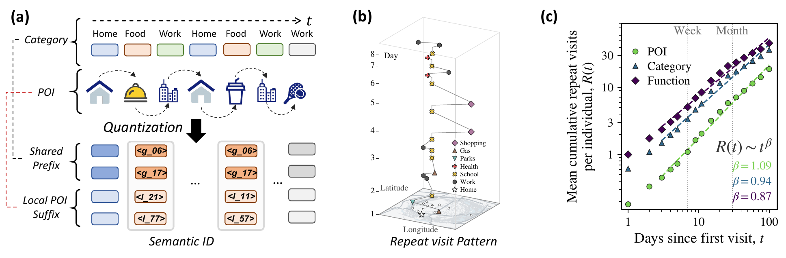
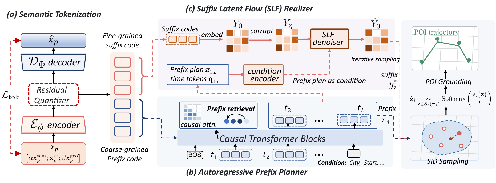
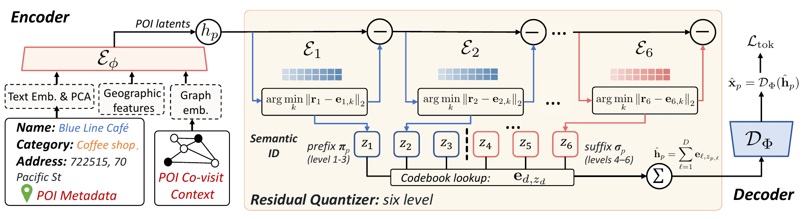

# SeMoFlow

SeMoFlow generates weekly mobility trajectories as timed visits to POIs in a
city catalog. This repository contains the code for the accompanying ICLR 2027
paper submission.

## Motivation

People revisit places at different levels: the same POI, another POI in the
same category, or a place with a similar function. SeMoFlow represents POIs
with hierarchical Semantic IDs (SIDs) so a model can learn both shared
patterns and place-specific behavior.



## Framework

The planner samples visit times and a coarse SID prefix for each visit. A
conditional flow-matching realizer completes the SID sequence. A catalog
decoder maps the resulting IDs back to POIs.



The tokenizer learns POI representations from text and can include geographic
features and co-visitation graph embeddings. Each model stage is trained
separately.

## Semantic IDs

The residual quantizer builds each SID from successive codebooks. Early codes
form a coarse prefix shared by related places; later codes distinguish more
specific POIs.



## Install

The dependency environment targets Linux x86_64 with Python 3.12–3.14.
Install with [uv](https://docs.astral.sh/uv/):

```bash
uv sync
```

## Data and preprocessing

Download the Foursquare global 2015 release from the
[dataset source page](https://sites.google.com/site/yangdingqi/home/foursquare-dataset)
and extract it under `data/foursquare_global_2015/`. The directory should
contain `dataset_TIST2015_Checkins.txt`, `dataset_TIST2015_POIs.txt`, and
`dataset_TIST2015_Cities.txt`. Then run:

```bash
uv run semoflow-preprocess --config configs/preprocess/foursquare.yaml
```

The [preprocessing config](configs/preprocess/foursquare.yaml) selects
Los Angeles, Washington, D.C., Atlanta, San Francisco, and Milwaukee. To use
another extracted directory:

```bash
uv run semoflow-preprocess --config configs/preprocess/foursquare.yaml \
  --set data.foursquare.archive_path=/path/to/extracted/release
```

The run writes `processed_visits.parquet`, `quality_scores.parquet`, and
`places_index.parquet` to `outputs/preprocessing/foursquare_five_city/`.

## Training and sampling

Each stage is a separate command. The sequence below continues from the
Foursquare preprocessing output and was checked end to end. Set `--device`
and the `device` fields in the YAML files for your hardware; every command
documents its options under `--help`.

```bash
T=outputs/tokenization/foursquare_five_city/dense_f_full
P=outputs/preprocessing/foursquare_five_city

# 1. Text and graph POI encoders, then the SID tokenizer.
uv run semoflow-train encoder --config configs/encoder/foursquare_five_city.yaml
uv run semoflow-train tokenizer \
  --config configs/tokenization/multi_city/foursquare_five_city/dense_full_transfer.yaml

# 2. Weekly segments, planner dataset, and planner. Multi-city catalogs need
#    city context so samples can be assigned to a city.
uv run semoflow-artifacts build-weekly-segments \
  --stays $T/augmented_processed_visits.parquet --output outputs/segments.parquet
uv run semoflow-artifacts build-occurrence-planner-dataset \
  --segments outputs/segments.parquet --lookup $T/placekey_lookup.parquet \
  --codebook-size 48 --context-mode city --output outputs/planner_dataset.pt
uv run semoflow-train planner \
  --dataset outputs/planner_dataset.pt --output-dir outputs/planner

# 3. Realizer bank and realizer.
uv run semoflow-artifacts build-realizer-bank \
  --lookup $T/placekey_lookup.parquet --segments outputs/segments.parquet \
  --output outputs/bank.pt
uv run semoflow-train realizer --bank outputs/bank.pt \
  --codebooks $T/tokenizer_codebooks.pt --codebook-size 48 \
  --catalog-path $T/placekey_lookup.parquet --output-dir outputs/realizer

# 4. Sample plans. CITIES.parquet has one row per sample with a city_id
#    column (IDs are in src/semoflow/config/constants.py).
uv run semoflow-artifacts build-occurrence-planner-conditions \
  --checkpoint outputs/planner/best.pt --input CITIES.parquet \
  --output outputs/conditions.pt
uv run semoflow-eval sample-plans --checkpoint outputs/planner/best.pt \
  --conditions outputs/conditions.pt --num-samples N --output outputs/plans.pt

# 5. Compose plans into grounded POI trajectories and evaluate them.
uv run semoflow-eval compose --realizer-checkpoint outputs/realizer/best.pt \
  --planner-samples outputs/plans.pt --planner-checkpoint outputs/planner/best.pt \
  --bank outputs/bank.pt --codebooks $T/tokenizer_codebooks.pt \
  --lookup $T/placekey_lookup.parquet --grounding-index $T/grounding_index.pkl \
  --places $P/places_index.parquet --max-samples N --output outputs/composition.json
```

The other files in [`configs/`](configs/) record the encoder and tokenizer
recipes for the Veraset cities. They read processed Veraset data, which is
not distributed (see below).

## Released checkpoints

[`veraset_checkpoints/`](veraset_checkpoints/) holds trained models for
Boston, Chicago, Dallas, New York City, and Pittsburgh. Each city directory
contains:

- `planner.pt`: the autoregressive prefix planner.
- `realizer.pt`: the suffix latent-flow realizer, with its tokenizer
  codebooks embedded.
- `grounding.pkl`: the index that maps full SIDs to catalog POIs
  (placekey, category, NAICS code, and coordinates).

The models were trained on Veraset visit data. Its license does not allow
redistribution, so neither the raw nor the processed Veraset data is
included, and the public preprocessing pipeline covers Foursquare only. The
planner checkpoints sample on their own:

```bash
uv run semoflow-eval sample-plans \
  --checkpoint veraset_checkpoints/chicago/planner.pt \
  --output outputs/samples/chicago_plans.pt --num-samples 1000
```

Composing plans into grounded POI trajectories with `semoflow-eval compose`
also needs the city's validation bank, SID lookup, and places table, which
are derived from the licensed data. The resulting trajectories are released
below.

## Sample trajectories

[`sampled_data/`](sampled_data/) contains 30,000 generated trajectories per
city for the five cities above. Each Parquet row is one visit:
`trajectory_id` and `event_index` give its position, `placekey_id` and
`placekey` identify the grounded POI, `top_category`, `naics_code`,
`latitude`, and `longitude` describe it, and `sem_code_0`–`sem_code_5` hold
its SID. When an SID matches several POIs, `grounding_candidate_count` gives
the number of matches and `poi_selection` records how one was chosen
(sampled from a prior fitted on training visits). The files contain no real
device identifiers or timestamps.
