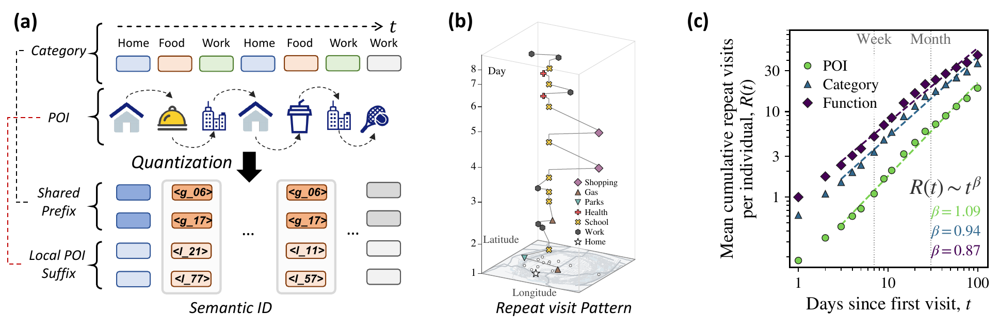
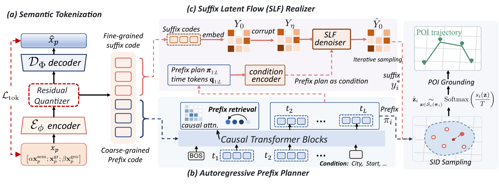
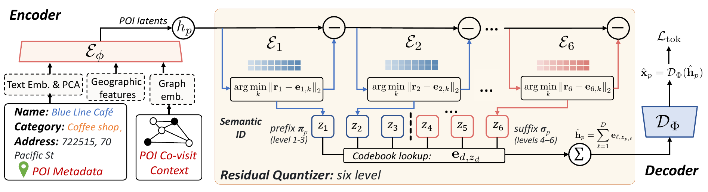

# SeMoFlow

SeMoFlow generates weekly mobility trajectories as timed visits to POIs in a
city catalog.

This repository contains:

- The full pipeline: [preprocessing](#data-and-preprocessing),
  [training](#training), and [sampling](#sampling), runnable end to end on
  the public Foursquare dataset.
- [Trained checkpoints](#released-checkpoints) for Boston, Chicago, Dallas,
  New York City, and Pittsburgh.
- [30,000 generated trajectories per city](#sample-trajectories) from those
  checkpoints.

## Method

### Motivation

People revisit places at different levels: the same POI, another POI in the
same category, or a place with a similar function. SeMoFlow represents POIs
with hierarchical Semantic IDs (SIDs) so a model can learn both shared
patterns and place-specific behavior.



### Framework

The planner samples visit times and a coarse SID prefix for each visit. A
conditional flow-matching realizer completes the SID sequence. A catalog
decoder maps the resulting IDs back to POIs.



The tokenizer learns POI representations from text and can include geographic
features and co-visitation graph embeddings. Each model stage is trained
separately.

### Semantic IDs

The residual quantizer builds each SID from successive codebooks. Early codes
form a coarse prefix shared by related places; later codes distinguish more
specific POIs.



## Install

The dependency environment targets Linux x86_64 with Python 3.12–3.14.
Install with [uv](https://docs.astral.sh/uv/):

```bash
uv sync
```

## Data and preprocessing

Download the **Global-scale Check-in Dataset** from the
[Foursquare dataset page](https://sites.google.com/site/yangdingqi/home/foursquare-dataset)
and extract these files:

```text
data/foursquare_global_2015/
├── dataset_TIST2015_Checkins.txt
├── dataset_TIST2015_POIs.txt
└── dataset_TIST2015_Cities.txt
```

```bash
uv run semoflow preprocess --config configs/foursquare.yaml
```

This prepares **Los Angeles, Washington DC, Atlanta, San Francisco, and
Milwaukee** in `outputs/preprocessing/`: check-in visits and the POI catalog.

## Training

One file, [`configs/foursquare.yaml`](configs/foursquare.yaml), holds the
whole experiment: a section per stage, and `run_dir`, under which every stage
reads and writes its artifacts. Run the stages in order from the repository
root, passing the same file to each:

```bash
export CUDA_VISIBLE_DEVICES=0
C=configs/foursquare.yaml

uv run semoflow encoder --config $C
uv run semoflow tokenizer --config $C

uv run semoflow planner-data --config $C
uv run semoflow planner --config $C

uv run semoflow realizer-data --config $C
uv run semoflow realizer --config $C
```

| Stage | Output under `run_dir` (default `outputs/`) |
| --- | --- |
| Preprocessing | `preprocessing/` |
| Encoders | `encoder/text/text_embeddings.pt`, `encoder/graph/` |
| Tokenizer | `tokenization/` |
| Planner data and model | `segments.parquet`, `planner_dataset.pt`, `planner/best.pt` |
| Realizer data and model | `bank.pt`, `realizer/best.pt` |
| Evaluation | `evaluation/<city>/` |

Override any setting with `--set`, for example `--set run_dir=/data/run1` to
place a whole experiment elsewhere or `--set planner.epochs=20`.
`semoflow config --config $C` prints the config with your overrides applied,
and each stage saves it as `config_resolved.yaml` in its output directory.
`semoflow --help` lists every stage. Every stage defaults to `cuda:0`; select the physical GPU with
`CUDA_VISIBLE_DEVICES`. The text encoder reuses
`encoder/text/text_embeddings.pt` when it already covers the POI catalog.

For multi-GPU training, give the encoder, planner or realizer a device list;
each starts one DDP rank per GPU:

```bash
uv run semoflow planner --config $C --set 'planner.device=[0,1]'
uv run semoflow realizer --config $C --set 'realizer.device=[0,1]'
```

## Sampling

**Generate and evaluate all five cities** with one command. Trajectory lengths
are sampled; the test set supplies the number of trajectories to generate.

```bash
uv run semoflow evaluate --config configs/foursquare.yaml
```

Results are saved under `outputs/evaluation/<city>/`:

| File | Contents |
| --- | --- |
| `plans.pt` | Sampled lengths, visit times, and SID prefixes |
| `generated_full_sids.pt` | Completed SID trajectories |
| `composition.json` | Fidelity metrics, including the ten JSD scores; lower is better |

The `summary` block of `composition.json` reports, for the gold-prefix and
sampled-plan arms:

| Key | Measures |
| --- | --- |
| `poi_frequency_jsd`, `geohash_jsd` | POI and geohash visit frequencies |
| `travel_jsd`, `radius_jsd` | Step distance and radius of gyration |
| `mobility_motif_jsd` | Daily mobility motifs |
| `mobility_recurrence_pattern_jsd` | Return gaps, in visit indices |
| `time_location_joint_jsd` | Weekly time token × geohash-5 cell of each visit |
| `gap_distance_joint_jsd` | Time gap × distance of consecutive visits |
| `inter_return_time_jsd` | Elapsed hours between returns to a POI |
| `return_index_time_joint_jsd` | Return index × elapsed return time |

The two elapsed-time metrics need continuous event clocks: observed
timestamps for the reference and the planner's sampled times for generated
plans. A plan without a clock reports them as unavailable.

**Catalog noise coupling.** By default each visit draws its POI
independently from the realizer's catalog posterior. Setting
`composition.catalog_noise_coupling: trajectory_prefix` (or
`--catalog-noise-coupling trajectory_prefix` on `semoflow compose`)
shares the sampling noise among a trajectory's visits with the same planned
prefix. Each visit keeps its own probabilities, but repeated visits to an area
tend to return to the same place. It applies only to the calibrated catalog
decoder.

Evaluation covers every city in `data.cities`; to run one city, append
`--set "evaluation.cities=[atlanta]"`.

### Sample a released planner

```bash
uv run semoflow sample-plans \
  --checkpoint veraset_checkpoints/chicago/planner.pt \
  --output outputs/samples/chicago_plans.pt --num-samples 1000
```

Grounded generation also requires the unreleased Veraset catalog artifacts.
Ready-to-use POI trajectories are available [below](#sample-trajectories).

## Released checkpoints

Models trained on Veraset are in [`veraset_checkpoints/`](veraset_checkpoints/).
The licensed raw and processed Veraset data are not included.

| City | Planner | Realizer | Grounding index |
| --- | --- | --- | --- |
| Boston | [24 MB](veraset_checkpoints/boston/planner.pt) | [38 MB](veraset_checkpoints/boston/realizer.pt) | [15 MB](veraset_checkpoints/boston/grounding.pkl) |
| Chicago | [25 MB](veraset_checkpoints/chicago/planner.pt) | [38 MB](veraset_checkpoints/chicago/realizer.pt) | [25 MB](veraset_checkpoints/chicago/grounding.pkl) |
| Dallas | [53 MB](veraset_checkpoints/dallas/planner.pt) | [38 MB](veraset_checkpoints/dallas/realizer.pt) | [22 MB](veraset_checkpoints/dallas/grounding.pkl) |
| New York City | [25 MB](veraset_checkpoints/new_york_city/planner.pt) | [38 MB](veraset_checkpoints/new_york_city/realizer.pt) | [47 MB](veraset_checkpoints/new_york_city/grounding.pkl) |
| Pittsburgh | [24 MB](veraset_checkpoints/pittsburgh/planner.pt) | [38 MB](veraset_checkpoints/pittsburgh/realizer.pt) | [8 MB](veraset_checkpoints/pittsburgh/grounding.pkl) |

Each realizer includes its tokenizer codebooks. The grounding index maps full
SIDs to POIs and their metadata.

## Sample trajectories

[`sampled_data/`](sampled_data/) contains **30,000 generated trajectories per
city**, with no real device identifiers or timestamps.

| City | Trajectories | Visits | Size |
| --- | --- | --- | --- |
| [Boston](sampled_data/boston/generated_poi_trajectories_30k.parquet) | 30,000 | 700,376 | 13 MB |
| [Chicago](sampled_data/chicago/generated_poi_trajectories_30k.parquet) | 30,000 | 701,044 | 15 MB |
| [Dallas](sampled_data/dallas/generated_poi_trajectories_30k.parquet) | 30,000 | 724,826 | 15 MB |
| [New York City](sampled_data/new_york_city/generated_poi_trajectories_30k.parquet) | 30,000 | 753,268 | 18 MB |
| [Pittsburgh](sampled_data/pittsburgh/generated_poi_trajectories_30k.parquet) | 30,000 | 629,518 | 11 MB |

Each row represents one visit:

| Columns | Contents |
| --- | --- |
| `trajectory_id`, `event_index` | Trajectory and visit order |
| `placekey_id`, `placekey` | Grounded POI |
| `top_category`, `naics_code` | POI category |
| `latitude`, `longitude` | Coordinates |
| `sem_code_0`–`sem_code_5` | Coarse-to-fine SID |
| `grounding_candidate_count`, `poi_selection` | Candidate count and selection policy |

```python
import polars as pl

visits = pl.read_parquet(
    "sampled_data/chicago/generated_poi_trajectories_30k.parquet"
).sort("trajectory_id", "event_index")
```
